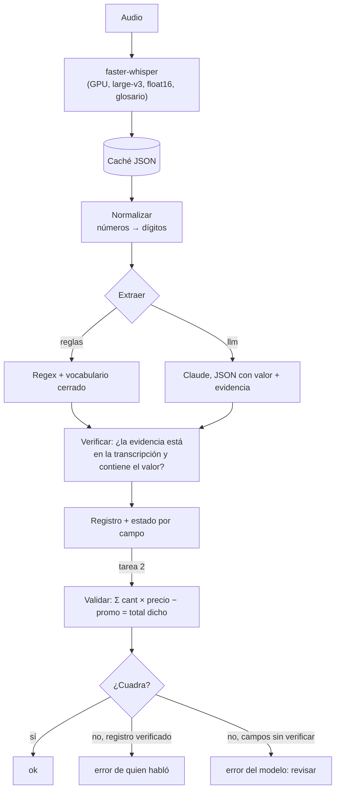

# Pipeline · De la voz al registro

> Este documento es el borrador del pipeline. La versión que se entrega va en **Notion** (pública) y
> se enlaza desde el README. Copia y pega cada sección en una página de Notion.

## 1. Qué corre una vez

| Paso | Qué hace | Dónde |
|---|---|---|
| Guiones | Escribir 4 entrevistas y 4 llamadas inventadas, con los campos en posiciones distintas y trampas a propósito | `data/guiones/` |
| Respuestas correctas | Tabla con el valor correcto de cada campo y qué trampas tiene cada llamada | `data/verdad/verdad_tarea*.csv` |
| Transcripción de referencia | El texto del guion sin las etiquetas A/B (corregido a mano si al grabar se dijo otra cosa) | `scripts/referencias.py` |
| Grabación | Una sesión por tarea, celular a 30 cm, cuarto en silencio | — |
| Elegir el modelo | Experimentos de la fase 2: tamaño, CPU/GPU, precisión, glosario | Colab (`notebooks/colab_gpu.ipynb`) |
| Escalera de degradación | L1 nota de voz, L2 teléfono, L3 L1 + ruido | `scripts/degradar.py` |

## 2. Qué corre por cada audio

Todo lo de la derecha de la caché corre en la laptop o en GitHub Actions, sin GPU.

## 3. Decisiones y opciones descartadas

| Decisión | Por qué | Opciones descartadas |
|---|---|---|
| faster-whisper | Lo vimos en clase, soporta español, corre en GPU y en CPU (int8) y permite medir precisiones | Qwen3-ASR, Parakeet y Voxtral también entienden español, pero no entraron en la comparación por tiempo (quedan como trabajo futuro) |
| Grabar audios propios | La consigna lo exige; además el audio sintético es demasiado limpio | Edge TTS como corpus principal (solo serviría como grupo aparte) |
| Transcribir en Colab y guardar caché | La laptop no tiene GPU (Intel Iris Xe) y GitHub Actions tampoco | Transcribir al abrir la app (lento y no reproducible) |
| Un motor, dos esquemas | `procesar(audio, esquema)`: el esquema dice qué campos buscar y cómo verificarlos. La tarea 2 reutiliza todo y solo agrega la validación | Copiar el código de la tarea 1 |
| Evidencia + verificación literal | Ningún valor entra al registro si no se puede señalar dónde se dijo. Evita que el LLM invente | Confiar en el LLM sin evidencia |
| Normalizar números antes de comparar | "cuatro mil quinientos" y "4.500" son lo mismo; sin esto el WER castiga diferencias de formato | Comparar texto crudo |
| Tarea 2: leer la confirmación del vendedor | Es el pedido final, ya con las correcciones; si no está, se recorre la llamada aplicando los cambios | Sumar todas las menciones (duplica lo que el vendedor repite) |
| Diagnóstico error ASR vs. error del hablante | Si la cuenta no cuadra y todo está verificado, culpa de quien habló; si hay campos sin verificar, culpa del modelo | Marcar todo como error sin explicar |

## 4. Qué NO debe hacer este sistema

- Decidir a quién contratar: la ficha resume lo dicho, no evalúa a la persona.
- Cobrar o despachar un pedido sin revisión cuando hay una alerta.
- Usarse con grabaciones de personas que no dieron su consentimiento.

## 5. Agentes de IA y servidores MCP usados

| Herramienta | Para qué |
|---|---|
| Claude Code (app de escritorio) | Escribir guiones, código, pruebas y documentación con revisión mía |
| (completar) servidores MCP conectados | (una línea cada uno) |
